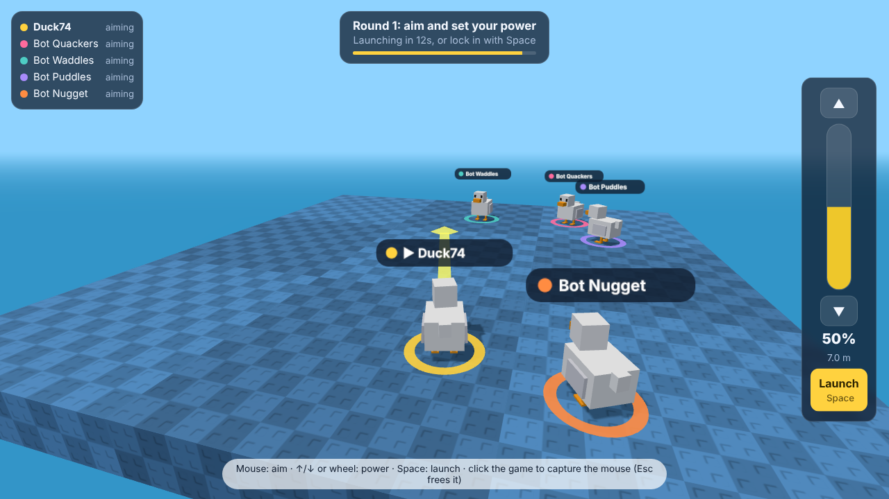

# Tumbler

Slide your duck, bump the others off the grid, be the last one alive.

## Play
- **On GitHub Pages:** push to `main`, then in the repo go to Settings -> Pages -> Source: **GitHub Actions**. The included workflow runs the tests and publishes the site. "Play vs bots" works there. Online rooms are switched off automatically because Pages has no game server.
- **Locally, with online rooms:**

      npm install
      npm start        # http://localhost:8080  (PORT=3000 npm start to change)
      npm test         # sim, GLB reader and interpolation tests (Node >= 20)

- **Static only, no Node:** serve the repo folder with any static server (`npx serve .`) and open it.

Online rooms need a Node host (Render, Fly, Railway, your own box) running `npm start`. Rooms hold up to 5 ducks; when the host starts, empty seats are filled with bots, and a bot takes over any duck whose player leaves.

## Controls
Mouse: aim (click the game to capture the mouse; if pointer lock is unavailable, drag to look) · Up/Down arrows, W/S, mouse wheel or the on-screen arrows: power · Space or Enter: lock in / unlock · Esc frees the mouse.

## Flow
5 s countdown -> everyone teleports to a random spot -> aim + power (12 s, or when everyone has locked in) -> all ducks slide at once and can bump each other -> repeat until one duck is left. A duck whose centre leaves the grid is out.

## Layout
- `index.html`, `client/`: three.js view, HUD, input, snapshot interpolation. All paths are relative, so it works under `user.github.io/repo/`.
- `shared/`: the whole game (`sim.js`, `bot.js`), the GLB reader (`glb.js`) and every tunable (`config.js`, tagged [USER] / [GLB] / [DESIGN]; all [DESIGN] values are uncalibrated, tune by feel). Runs unchanged in browser and server.
- `server/server.js`: static files + authoritative rooms (WebSocket, `ws`).
- `assets/`: `Grid.glb`, `TumblerDuck.glb`. `vendor/three/`: pinned three.js 0.160.0 (MIT, see `VENDORED.txt`).
- `test/`: Node tests. `.github/workflows/pages.yml`: test + deploy.

## Facts read from the .glb files (not hardcoded)
Grid.glb: 9 contiguous 5x5 tiles, top surface y=1.15, footprint 15x15 m (x,z in [-7.5, 7.5]).
TumblerDuck.glb: origin at the feet, faces +Z, 1.125 m tall, clips `idle` (loop), `sit_down`, `stand_up`.
